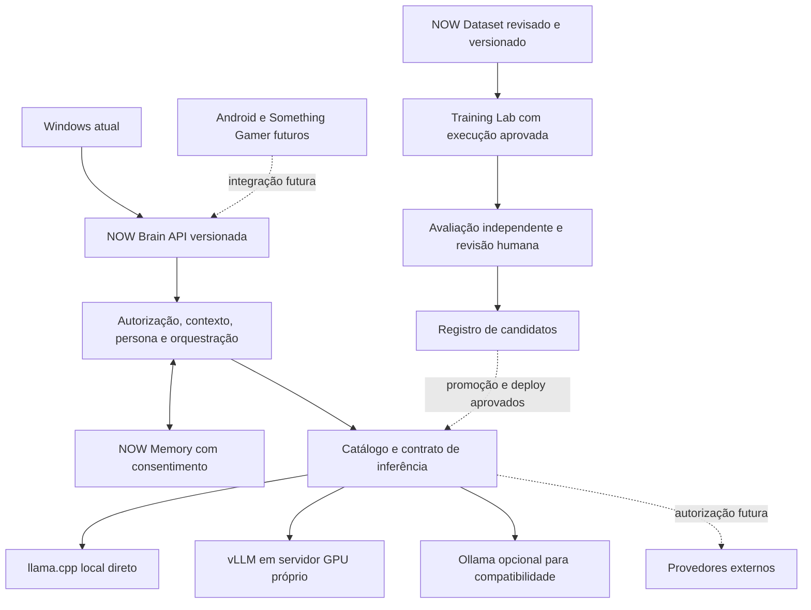

# NOW Brain — plataforma independente e Training Lab

Proposta para revisão, 17/11/2026. **Não autoriza treinamento, compra de recursos,
promoção de modelos ou deploy.** Base auditada: `work`,
`06be7a941c993fff5528426e0184e7b09bef519a`. Esta direção substitui a ideia de
Ollama obrigatório como destino da plataforma. Preserva a aplicação existente.

## Resultado pretendido e estado real

A plataforma proposta coloca sob controle da NOW a API, os contratos, o contexto,
o consentimento, a memória, os dados, a avaliação e o ciclo de seus candidatos. Modelos de pesos
abertos entram como componentes licenciados e substituíveis. Adaptar esses pesos
por fine-tuning é diferente de pré-treinar um modelo fundacional do zero; este
último exige outro projeto, corpus, equipe e orçamento.

| Área | Auditada hoje | Evolução proposta, ainda não implementada |
| --- | --- | --- |
| API e Windows | `/api/now/v1`, SSE, cancelamento, seleção de modelo e rollback `/v2` | Catálogo e adaptadores independentes de Ollama |
| Inferência | `ModelProvider` existe, mas a implementação concreta é Ollama | llama.cpp direto no Windows; vLLM em servidor próprio |
| Memória | Histórico e preferências opcionais em cofres criptografados separados | Sugestões de preferências com confirmação; fatos com edição/exclusão e consentimento |
| Dataset | 36 exemplos piloto; licença/autoria não verificadas, treino bloqueado | Corpus próprio/público/licenciado com direitos e versões auditáveis |
| Training Lab | Validador e script experimental LoRA; GPU nunca validada | Jobs isolados, ambiente reproduzível, autorização por execução e registro de candidatos |
| Avaliação | 12 casos do kit e 20 casos conversacionais separados; utilitário Windows | Avaliação comum a todos os backends e comparação baseline/candidato |
| Hospedagem | Serviço local autenticado em loopback | Identidade, isolamento, TLS, quotas e operação em servidor GPU |

O candidato Windows anterior continua utilizável para revisão. Os testes
históricos da Fase 6 são 139 aprovados em Linux e 138 aprovados/um POSIX não
aplicável no Windows Server 2022. Não foram repetidos nesta revisão documental;
os resultados e o artefato estão em [VALIDACAO.md](../VALIDACAO.md). Eles não
comprovam inferência, qualidade ou desempenho no Athlon/Windows 10.

### Acoplamentos que a migração precisa resolver

- `now_brain/api.py` instancia `OllamaProvider` e lê seu modelo padrão.
- `now_brain/orchestrator.py` fixa `provider_id="ollama"` para respostas geradas.
- `now_brain/contracts.py` limita os identificadores de provedor a Ollama/offline.
- `now_desktop/engine_client.py` aceita esses nomes e associa Ollama à origem local.
- `now_desktop/client_config.py` reutiliza a validação de tags do adaptador Ollama.

A API tem identidade e rotas próprias, mas sua inferência ainda depende desse
adaptador. Injeção de dependência, por si só, não concluiu a independência.

## Arquitetura

Não existe fluxo automático de conversas ou de NOW Memory para o dataset. O
Training Lab opera separado da API de atendimento; usuários de chat não podem
disparar treinamento ou promover modelos por uma instrução ao modelo.

### Contrato e catálogo da NOW

Manter `/api/now/v1` como contrato do produto, sem expor ao cliente detalhes de
um servidor de inferência. IDs estáveis do catálogo identificam o artefato; a
tag de Ollama, caminho GGUF ou nome no vLLM fica no adaptador. O servidor decide
quais modelos estão aprovados e disponíveis. O cliente não fornece URL arbitrária
de backend nem caminho de arquivo para carregar pesos.

Cada adaptador normaliza inventário, seleção explícita, fluxo de texto, término,
erros e cancelamento. Deve declarar suporte a cancelamento e métricas. Tokens/s
fica ausente quando o runtime não informa tokens e duração confiáveis; caracteres/s
não pode receber esse rótulo. Fechar a conexão só conta como interrupção de
computação quando o backend comprovar essa capacidade.

Separar identidade do backend e local de execução: um serviço com protocolo
compatível com OpenAI pode estar inteiramente em infraestrutura própria. Esse
protocolo não exige usar a API comercial da OpenAI. A UI deve mostrar modelo e
origem reais, sem fallback silencioso para processamento remoto.

Versionar mudanças aditivas e testar compatibilidade dos eventos SSE. A GUI
atual valida provedores com uma lista fechada: não anunciar um novo provedor a
clientes antigos sem negociar capacidade ou exigir atualização compatível.
Manter `/v2`, configuração de rollback, testes e cofres existentes durante a
migração. Não renomear ou migrar silenciosamente bancos criptografados.

### Execução de pesos abertos

1. **Windows/CPU: llama.cpp.** Integrar diretamente o runtime/servidor local,
   com modelo GGUF de revisão e licença verificadas. Empacotamento, integridade
   do binário, compatibilidade de instruções de CPU, licença de redistribuição,
   ciclo de vida do processo e cancelamento exigem testes no Windows 10 alvo.
   Não presumir que o build mais recente serve ao Athlon.
2. **GPU própria: vLLM.** Opção inicial para Linux/CUDA, streaming e múltiplas
   requisições, em conta/servidor controlado pela NOW. A API pública continua
   sendo a da NOW; o runtime fica em rede privada. Validar arquitetura do modelo,
   quantização, KV cache e suporte do hardware antes de fixar o executor.
3. **Compatibilidade: Ollama.** Preservar o adaptador já usado pelo candidato e
   pela avaliação Windows; não obrigar sua instalação na arquitetura final.
4. **Externos futuros.** GPT/Gemini somente com autorização e termos aplicáveis,
   origem explícita e política de envio de dados. Não constituem requisito para
   iniciar a aplicação ou treinar/adaptar pesos abertos.

Nada nesta revisão instalou ou validou llama.cpp/vLLM. Os Qwen existentes no
Windows continuam candidatos à comparação, sem vencedor definido por tamanho.
Outro artefato/quantização precisa de sua própria medição, mesmo com a mesma
família de modelo.

## NOW Dataset e memória

**Contexto** são mensagens usadas na requisição atual. **Histórico** é o registro
opcional criptografado. **Memória** são preferências/fatos autorizados e editáveis.
**Treinamento** altera parâmetros/pesos. Salvar ou recuperar informação não
prova que o modelo aprendeu ou que passou a responder melhor.

Preservar a separação e as senhas dos cofres existentes. Preferências novas
podem ser sugeridas a partir da conversa, mas a gravação exige confirmação e
deve permitir consultar, editar, desabilitar e excluir. Contribuir para um
dataset exige autorização separada; ativar histórico ou memória não a concede.
Não disponibilizar conteúdo de cofres por rotas novas de administração.

O NOW Dataset deve aceitar apenas autoria própria verificável ou fontes com
permissões compatíveis. Disponível publicamente não significa licenciado para
treino. Registrar origem, autoria, licença/versão, uso comercial/redistribuição
permitidos, base de direitos, consentimento quando aplicável, revisão de dados
pessoais, idioma, domínio e hash do conteúdo. Rejeitar origem ou direitos
desconhecidos, em vez de completar esses campos por suposição.

Saídas de GPT/Gemini não entram no treino por padrão. Qualquer exceção exige
autorização expressa dos titulares/provedores aplicáveis e do projeto, além de
termos e licença compatíveis com o uso pretendido. Pagar por inferência ou ter
permissão para usar a API não concede automaticamente direito de treinar um
modelo concorrente. Relatórios de avaliação também não viram corpus de treino.

Separar treino, validação e teste por conversa/origem antes de experimentar;
revisar duplicação textual e semântica. Os 12 casos do kit e os 20 casos da
Fase 6 permanecem fora do treino. Para um piloto, planejar 1.000–10.000 exemplos
revisados PT-BR/EN como ordem de grandeza de curadoria, ajustando pela qualidade
observada; isso não é garantia de resultado nem requisito já atendido. Um
conjunto de teste humano maior e reservado virá antes de alegar qualidade
comercial. Os 100 exemplos exigidos pelo script atual são apenas um bloqueio
mínimo do protótipo.

## Training Lab: aprovações e rastreabilidade

O script existente faz LoRA experimental, não oferece um laboratório comercial
validado. Os ranges de bibliotecas não são um ambiente CUDA reproduzível;
QLoRA, agendamento distribuído e gates de promoção não estão implementados.
O bloqueio atual de procedência não substitui autorização humana por execução.

Antes de qualquer alteração de pesos, implementar e revisar estes controles:

1. **Dados e modelo-base:** aprovação do corpus e de seus hashes, revisão da
   licença da revisão exata do modelo, tokenizer e origem dos pesos.
2. **Experimento:** manifesto aprovado com código, datasets/splits, dependências
   travadas, seed, hiperparâmetros, GPU, horas máximas, teto de custo e responsável.
   Mudança relevante invalida a aprovação. Execução isolada, sem conversas da
   aplicação e sem acesso a segredos de produção.
3. **Avaliação:** comparar baseline e adaptador com os mesmos casos reservados,
   parâmetros e hardware; registrar respostas reais e avaliação humana de
   idioma, contexto, utilidade, naturalidade, humor, honestidade e privacidade.
   A queda de loss não basta para promover o modelo.
4. **Promoção e implantação:** aprovação separada, após avaliar conversão,
   quantização e runtime de destino. Registrar artefato imutável e hashes,
   modelo-base/adaptador/tokenizer, licença, datasets, código, métricas e revisão.
   Preservar baseline e rollback. Treinar não autoriza servir ou publicar pesos.

Começar com um experimento supervisionado de adaptação de 1,5–3B, se os dados,
o hardware e a licença forem aprovados. Não iniciar pré-treino fundacional,
aprendizado contínuo em produção ou autoaprovação pelo próprio modelo.

## Hardware: planejamento, sem benchmark neste ambiente

| Uso | Referência inicial | Limitação |
| --- | --- | --- |
| Cliente atual | Windows 10, Athlon 3000G, 8 GB RAM | API/UI e possível inferência CPU pequena quantizada; medir memória e latência. Não recomendado para fine-tuning produtivo |
| Desenvolvimento CPU | CPU moderna, 32 GB RAM, NVMe 1 TB | Dados, API, testes e modelos pequenos; não substitui GPU de treino |
| Piloto LoRA/QLoRA 1,5–3B | Linux/CUDA, GPU 16–24 GB VRAM, RAM 64 GB, NVMe 1–2 TB | Recomendar inicialmente GPU alugada de 24 GB; capacidade depende de precisão, contexto, batch e checkpoints |
| Piloto QLoRA 7–8B posterior | GPU 24 GB com restrições; 48 GB para margem, RAM 64–128 GB | Perfil de memória precisa ser testado; não é promessa de caber ou de throughput |
| Serviço GPU 3–7B | GPU 24–48 GB, RAM 64–128 GB, NVMe 1–2 TB | Referência para baixa concorrência; SLO e número de usuários só após carga real |

Uma conta útil apenas para **pesos**: 7 bilhões de parâmetros em FP16 ocupam
aproximadamente 14 GB decimais; 4 bits ideais, 3,5 GB. Runtime, metadados de
quantização, ativações, buffers e KV cache aumentam isso. Fine-tuning completo
com otimizador pode exigir aproximadamente 12–20 bytes por parâmetro antes das
ativações: cerca de 112 GB para 7B a 16 bytes/parâmetro. Não confundir essa
necessidade com a de LoRA/QLoRA ou recomendar treino completo em 24 GB.

## Custos estimados e premissas

**Faixas para planejar, não cotações verificadas.** As páginas de preços Runpod
e Lambda retornaram CONNECT 403 nesta rede em 17/11/2026. Não foi provisionado
recurso ou assumida despesa. Cotar região, GPU, disponibilidade, armazenamento,
tráfego e impostos antes de aprovar uma execução.

Para tornar a conta revisável, assumir GPU de 24–48 GB a **US$ 0,50–2,50/h** e
CPU/armazenamento de **US$ 20–80 por mês/piloto**. São premissas orçamentárias,
sem atribuição de tarifa a fornecedor.

| Cenário | Conta com essas premissas | Estimativa de infraestrutura |
| --- | --- | --- |
| Piloto com reserva de 20–80 horas GPU | GPU US$ 10–200 + apoio US$ 20–80 | US$ 30–280; sugerir teto inicial US$ 50–350 incluindo contingência, sujeito a aprovação |
| Serviço ligado 8 h/dia, 22 dias/mês | 176 h GPU + apoio | US$ 108–520/mês |
| Uma instância ligada 24 h/dia | 730 h/mês GPU + apoio | US$ 385–1.905/mês |
| Máquina própria de desenvolvimento | GPU CUDA 24 GB, RAM 64 GB, NVMe 2 TB e restante do computador | R$ 15–35 mil como envelope preliminar, sem cotação de varejo |

Horas do piloto são uma **reserva de orçamento**, não previsão de tempo de
treino. A instância contínua não inclui alta disponibilidade, réplicas,
engenharia, curadoria/revisão humana, impostos ou tráfego variável. Curadoria e
desenvolvimento precisam de orçamento próprio; não estão incluídos nesses
totais. Não foi feita conversão cambial. Como ilustração separada de energia,
0,5 kW × 80 h × R$ 1/kWh = R$ 40; carga, tarifa e refrigeração reais variam.
Nenhum desses valores estima o custo de pré-treinar um modelo fundacional.

## Sequência de incrementos e critérios de aceite

1. **Independência da inferência:** catálogo e contratos neutros; remover os
   acoplamentos auditados, manter Ollama como compatibilidade e v1/`/v2`.
   Testar regressões de protocolos, persistência/configuração e GUI. Não remover
   o caminho já utilizável antes de validar o substituto.
2. **llama.cpp funcional:** selecionar artefato licenciado e íntegro; executar
   inferência real, os 20 casos, contexto PT-BR/EN, SSE, desconexão e cancelamento
   no Windows alvo. Comparar com as tags Ollama instaladas, sem vencedor
   antecipado. Contratos com fixtures não comprovam inferência.
3. **Governança do Training Lab:** manifests de dados/modelos/execuções,
   aprovações verificáveis e ambiente GPU reproduzível. Validar a recusa de
   treinos sem aprovação, sem alterar pesos nesta preparação.
4. **Piloto supervisionado, somente aprovado:** baseline real, treino isolado,
   avaliação do candidato e relatório de custo/VRAM/tempo. Modelo reprovado
   permanece sem promoção; exportação/implantação exigem outra aprovação.
5. **Hospedagem, somente autorizada:** ambiente GPU, API protegida por TLS,
   identidade obtida de autenticação, isolamento por usuário, quotas, fila
   limitada, auditoria sem conteúdo privado e rollback testado. O token local
   atual não substitui autenticação/isolamento de um serviço multiusuário.

Medir separadamente carregamento a frio/quente, TTFT, tempo total, tokens/s
informados pelo runtime, erros/cancelamentos e pico RAM/VRAM. Registrar CPU/GPU,
modelo/revisão/quantização, contexto, limite de saída, runtime e parâmetros.
Reportar tamanho da amostra: 20 casos são uma avaliação inicial, insuficiente
para afirmar percentis estáveis ou qualidade comercial. Streaming melhora a
percepção de espera, sem comprovar aumento da velocidade de inferência.

Preservar logo, layout, cofres, testes, empacotamento e GitHub Actions. Não
alterar Something Gamer nem publicar releases/deploys nesta revisão. O próximo
incremento de implementação é o adaptador/catálogo neutro e inferência direta,
antes de abrir novas frentes de produto.

## Evidências desta revisão e referências

- [Validação e dry-run desta revisão](../validation/platform-direction-20261117/audit.json):
  36 registros de treino, 12 de avaliação, zero problemas estruturais; 19 testes
  do pipeline aprovados. Dry-run não executou treinamento nem checou GPU.
  A ausência de licença/aprovação, validação separada e corpus suficiente
  continua bloqueando treino. Validação de formato não concede direitos.
- [Proveniência do piloto](../training/data/PROVENANCE.json) e
  [política de dados](DATA_POLICY.md).
- Documentação oficial consultada em 17/11/2026:
  [llama.cpp](https://github.com/ggml-org/llama.cpp),
  [vLLM](https://github.com/vllm-project/vllm),
  [PEFT](https://github.com/huggingface/peft),
  [TRL](https://github.com/huggingface/trl). Fundamentam a seleção de componentes;
  não substituem validação da versão/hardware que será adotada.
- Preços não consultáveis nesta rede:
  [Runpod](https://www.runpod.io/pricing) e
  [Lambda](https://lambda.ai/service/gpu-cloud). As faixas acima são premissas
  declaradas, não valores extraídos dessas páginas.
