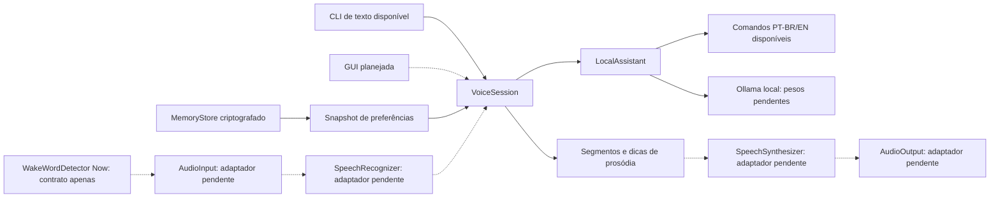
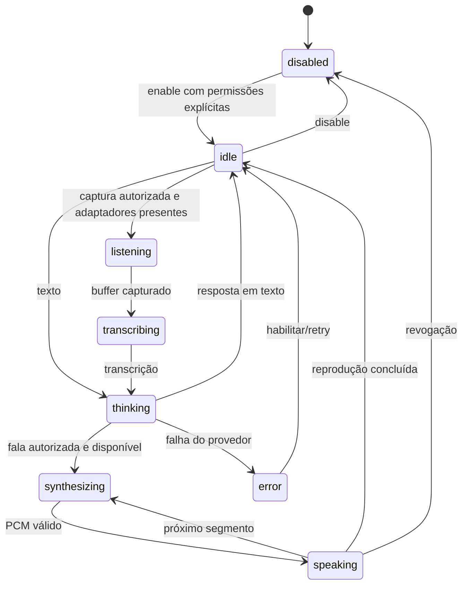

# NOW Voice Engine — incremento de arquitetura

Este incremento entrega contratos, controlador de sessão, planejamento de fala e um cliente de texto. Não instala motor de microfone, STT, TTS ou detector de palavra-chave. Não há áudio real ou qualidade vocal validada.

## Executar agora

Na raiz do projeto, com o ambiente Python existente:

```bash
.venv/bin/python -m now_voice --capabilities
TZ=America/Sao_Paulo .venv/bin/python -m now_voice --text "horas" --language pt-BR
TZ=America/Sao_Paulo .venv/bin/python -m now_voice --text "time" --language en-US
```

Os comandos determinísticos retornam texto real sem Ollama. O resultado inclui um plano de segmentos/pausas; `playback_completed=false` e `mode=text` significam que nenhum áudio foi sintetizado ou reproduzido. Pedir `--speak` sem adaptadores retorna `CAPABILITY_UNAVAILABLE`. `wake_word=false` permanece explícito.

Perguntas livres usam `now_engine.assistant.LocalAssistant`: verifica inventário local, recusa tags/entradas cloud, monta instruções gerais Casual e envia somente para o Ollama em loopback. Não usa Gemini. Esse caminho generativo ainda depende do download do Qwen e de testes reais; não foi aprovado apenas por existir código de integração. A API/CLI originais continuam usando seus módulos preservados.

## Contratos e composição



`now_voice/contracts.py` define áudio PCM16 limitado a 30 segundos, idiomas, preferências imutáveis, permissões e portas de captura, reconhecimento, síntese, saída e wake word. Os limites são validações de buffer, não benchmarks de qualidade.

`SpeechPlan` mantém as dicas de estilo, velocidade e pausas separadas do texto. Não injeta etiquetas de controle na fala. Cada segmento tem até 240 caracteres; pontos de sentença recebem pausa planejada de 280 ms, outros cortes 100 ms, escalados pela preferência. Esses números são heurísticas testadas estruturalmente, não uma avaliação perceptiva de naturalidade. Abreviações, entonação, sotaques e ritmo precisam de avaliação audível posterior.

O estilo expressivo só é repassado quando o sintetizador declara suporte; há fallback neutro explícito. Humor e persona entram nas instruções do novo adaptador textual, sem inserir piadas artificiais no áudio. O modelo ainda precisa demonstrar comportamento adequado com gerações reais.

## Máquina de estados e permissões



O controlador é síncrono e deve rodar em worker da aplicação. Impede requisições concorrentes, permite cancelamento cooperativo e revoga permissões ao desabilitar. Captura e reprodução exigem permissões distintas; processamento remoto exige consentimento separado e metadados de localidade de todos os adaptadores. Preferências persistidas nunca concedem acesso ao microfone.

Não são mantidos arquivos de áudio ou histórico pelo controlador. O estado de erro guarda códigos, sem texto privado. Revogação impede etapas seguintes; interrupção de uma captura, síntese ou reprodução em andamento depende da cooperação do driver. A requisição HTTP do adaptador local pode aguardar até 90 segundos e ainda não tem interrupção ativa da geração. Não há latência de cancelamento real medida.

## Ativação por “Now” e próximos adaptadores

`WakeWordDetector` define o contrato local, mas não há modelo de detecção nem loop de escuta. A primeira entrega de áudio deve ser push-to-talk real. Depois de testar STT/TTS, medir falso acionamento, eco da própria voz, música/jogos e consumo no hardware-alvo antes de habilitar “Now”. Nenhum método deste incremento começa escuta em segundo plano.

Selecionar dispositivos, VAD, STT/TTS licenciados PT-BR/EN, cancelamento de eco, streaming e barge-in continuam pendentes. Voz expressiva depende do motor escolhido; não há alegação de voz “super natural” aprovada. Android exige implementação e validação próprias de permissões/foreground service; não se promete escuta contínua bloqueada.

## Testes e limites

Os testes de orquestração usam doubles explicitamente identificados e PCM silencioso de fixture. Eles verificam fluxo, permissões, erros e cancelamento, sem provar microfone, transcrição, síntese, entonação ou reprodução física. Os comandos de texto PT-BR/EN são código real executado sem chamadas a modelo. Consulte `../VALIDACAO.md` para as contagens executadas.
